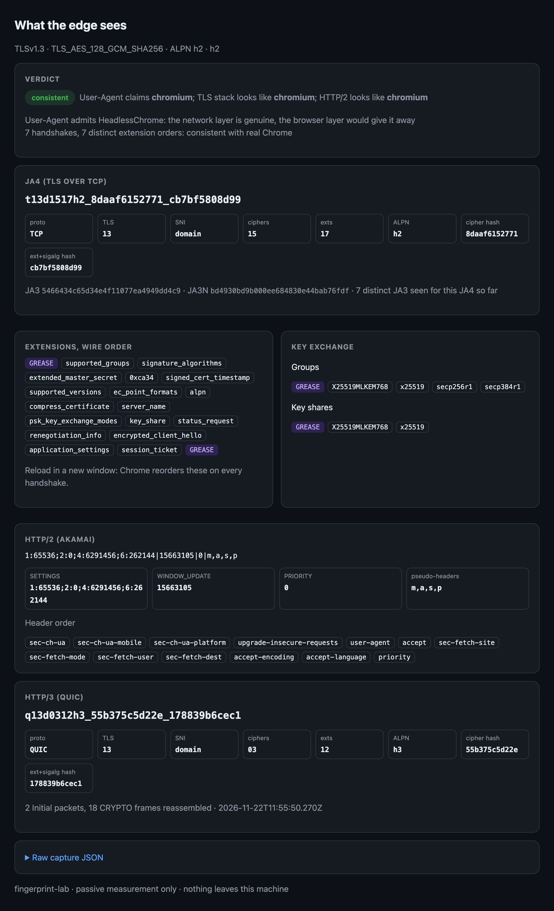
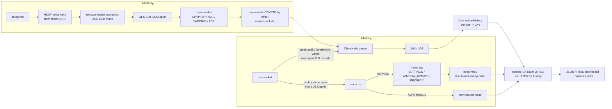

# fingerprint-lab

**See your client the way Cloudflare, Akamai or DataDome see it — over TCP *and* QUIC — before they do.**

A zero-dependency TypeScript edge sensor (Node ≥ 22.18 runs the `.ts` files directly). It reads the TLS ClientHello off the wire before any TLS library touches it, decrypts QUIC Initial packets from scratch (RFC 9001), taps the HTTP/2 connection preface, and answers every request with what a bot-management layer would conclude about it.

| Layer | What it extracts |
|---|---|
| TLS over TCP | JA3, JA3N, **JA4** (+ raw `_r` and wire-order `_ro` forms), GREASE, ALPS, ECH, post-quantum key shares |
| **TLS over QUIC** | Initial-packet decryption → CRYPTO-frame reassembly → **JA4 `q`**, QUIC transport parameters (62-bit GREASE ids included) |
| HTTP/2 | **Akamai fingerprint** `SETTINGS \| WINDOW_UPDATE \| PRIORITY \| pseudo-header order`, full frame order, header order |
| HTTP/1.1 | header order and casing exactly as sent |
| Across connections | extension-order entropy and GREASE reuse per (peer, JA4) — catches replayed "perfect" Chrome ClientHellos |



```sh
node src/server.ts             # https://localhost:8443/  TCP (h2/h1) + UDP (QUIC) on the same port
curl -sk https://localhost:8443/         # JSON; browsers get the dashboard above
npm test                       # 21 tests: published test vectors, live round trips, 30k fuzz cases
node scripts/collect.ts        # fingerprints every client on this machine -> results/REPORT.md
node scripts/bench.ts          # hot-path throughput
```

## Architecture



Design choices worth calling out:

- **Peek, then replay — no proxy, no second handshake.** The ClientHello is buffered until complete (a post-quantum key share alone is >1 KB, so it often spans records), parsed, and the identical bytes are pushed into a JS `Duplex` that Node's `TLSSocket` consumes.
- **Frames from the plaintext, headers from nghttp2.** A tap on decrypted bytes records connection frames; the same stream goes to `node:http2`, whose `rawHeaders` preserve order, so no HPACK decoder is needed.
- **QUIC without a QUIC stack.** The lab never answers on UDP. Initial keys are public by design (HKDF over the client's Destination Connection ID with the v1 salt), so a pure observer can remove header protection, recover the packet number, authenticate-decrypt the payload and rebuild the ClientHello. A spec-compliant encoder lives beside the decoder so tests can build adversarial packets.
- **BigInt where the spec demands it.** QUIC varints go to 2⁶²; Chrome's GREASE transport-parameter ids use that range, and a JS `number` silently corrupts them (this broke GREASE detection in an early version; there is a test for it now).

## Measured on this machine (22 Nov 2026 · macOS arm64 · Chrome 157 · Node 24.22)

Full tables, wire orders and frame layouts: [results/REPORT.md](results/REPORT.md) · raw: [results/captures.jsonl](results/captures.jsonl)

**TCP**

| Client | JA4 | HTTP/2 (Akamai) | Verdict |
|---|---|---|---|
| Chrome 157 (headless) ×5 | `t13d1517h2_8daaf6152771_cb7bf5808d99` | `1:65536;2:0;4:6291456;6:262144\|15663105\|0\|m,a,s,p` | consistent |
| curl 8.7.1 (macOS, LibreSSL) | `t13d4907h2_0d8feac7bc37_7395dae3b2f3` | `3:100;4:10485760;2:0\|1048510465\|0\|m,s,a,p` | consistent |
| **curl + Chrome UA + `sec-ch-ua`** | same as curl | same as curl | **MISMATCH** |
| Node 24 fetch (undici) | `t13d5212h1_b262b3658495_8e6e362c5eac` | h1 only | consistent |
| **Node `https` + Chrome UA** | `t13d521100_b262b3658495_8e6e362c5eac` | h1, no ALPN | **MISMATCH** |
| Node `http2` client | `t13d5212h2_b262b3658495_8e6e362c5eac` | `\|00\|0\|p,m,a,s` | — |
| Python 3.15 urllib | `t13d171100_ab0a1bf427ad_e44827223d20` | h1, no ALPN | consistent |
| **Python urllib + Chrome UA** | same as Python | — | **MISMATCH** |
| openssl s_client 4.1 | `t13d3012h1_1d37bd780c83_e44827223d20` | — | — |

**QUIC (HTTP/3)** — Chrome 157 forced onto QUIC, 3 fresh launches

| JA4 `q` | Initial packets | CRYPTO frames per ClientHello | Distinct JA3 / transport-param orders |
|---|---|---|---|
| `q13d0312h3_55b375c5d22e_178839b6cec1` | 2 | 12 – 18 | 3 / 3 of 3 |

## Findings

1. **A User-Agent is a claim; the handshake is evidence.** curl with a perfect Chrome UA *and* client hints still sends 49 ciphers, 7 extensions, no GREASE and curl's HTTP/2 SETTINGS. All three spoofing scripts were caught by three cheap checks: GREASE, ALPS (Chromium-only) and the HTTP/2 SETTINGS / WINDOW_UPDATE profile.
2. **JA3 is dead for Chrome; JA4 is not.** 5 Chrome launches → 5 JA3 hashes, 1 JA4, 1 JA3N. Chrome permutes ClientHello extensions on every connection (since v110); JA4 and JA3N sort them away.
3. **Published reference fingerprints go stale.** Chrome 157 sends 17 TCP extensions, not the 16 in FoxIO's reference `t13d1516h2_8daaf6152771_e5627efa2ab1`: the cipher hash is unchanged, the extension hash moved to `cb7bf5808d99` (GREASE-ECH `0xfe0d` plus a codepoint `0xca34` I could not identify in public registries). It leads its key shares with post-quantum `X25519MLKEM768`. Impersonation profiles need maintenance per release, not configuration once.
4. **The same browser has two TLS identities.** Over QUIC, Chrome is `q13d0312h3_…`: 3 TLS 1.3-only ciphers, 12 extensions (adds `quic_transport_parameters`, drops TCP-only ones). A blocklist or allowlist keyed only on the TCP JA4 never sees HTTP/3 traffic.
5. **Chrome actively resists naive QUIC parsing ("chaos protection").** Each ClientHello arrived cut into 12–18 CRYPTO frames, shuffled across 2 Initial packets, interleaved with PINGs and random PADDING runs, e.g. `PING CRYPTO[1006+325] PADDING(115) PING PADDING(1) CRYPTO[1876+6] … CRYPTO[0+63] …`. A sensor that reads only the first packet or assumes one contiguous CRYPTO frame sees nothing usable; offset-based reassembly across packets is required.
6. **QUIC transport parameters are permuted and GREASEd too.** 3 launches → 3 distinct parameter orders, each with a random 62-bit GREASE id (`31·N+27`) and a GREASE version inside `version_information`. Chrome also sends `google_connection_options = ORIG`.
7. **Node's HTTP/2 client is trivially identifiable:** an *empty* SETTINGS frame, no connection WINDOW_UPDATE, no User-Agent, and pseudo-headers in whatever order the caller's object lists them (`p,m,a,s`). Browsers are `m,a,s,p` (Chromium), `m,p,a,s` (Firefox), `m,s,p,a` (Safari).
8. **No ALPN = not a browser.** Python urllib and Node `https` send no ALPN (`…00` in JA4_a). Every browser offers `h2,http/1.1`.
9. **Headless Chrome passes the network layer and fails the application layer** — its UA says `HeadlessChrome/157`. Detection moves up to JS/browser signals, which is where a production scraper has to manage it.

## Catching the "perfect" impersonator

Copying one Chrome ClientHello byte for byte (uTLS, curl-impersonate) defeats every single-connection check above. What it does not reproduce is Chrome's *distribution*: a fresh extension permutation (~15! ≈ 1.3·10¹² orders) and fresh GREASE values per handshake. `src/history.ts` tracks both per (peer, JA4):

| Behaviour over N handshakes | Verdict | Test |
|---|---|---|
| fresh order + fresh GREASE every time (real Chrome) | consistent, "N distinct orders" | `history.test.ts` |
| identical bytes every time | **MISMATCH** at the 3rd handshake; GREASE reuse flagged at the 4th | `history.test.ts` |
| shuffles, but cycles through a small pool of orders | **MISMATCH** ("order repeated: 2 distinct in 6") | `history.test.ts` |

These detector tests use synthetic ClientHellos; no impersonation library was available on this machine to measure.

## Verification

- **Published test vectors:** JA3 (Salesforce README), JA4 end to end from raw bytes (FoxIO spec example), QUIC Initial secrets / keys / IVs / header-protection keys for client and server and the header-protection mask (RFC 9001 Appendix A.1–A.2), varint examples (RFC 9000 Appendix A.1).
- **Adversarial construction:** Chrome-style chaos-protected Initials built by the in-repo RFC 9001 encoder, fed out of order; coalesced packets; a single flipped bit must fail AES-GCM authentication.
- **Fuzzing:** every run mutates 20,000 ClientHellos/records, 5,000 QUIC datagrams and 5,000 HTTP/2 streams (byte flips, length-field boundary values, truncation). Parsers must reject with a normal `Error` or report "need more bytes" — and a collector hit by 5,000 hostile datagrams must still decode a clean one afterwards. `FUZZ_N=200000 npm test` for a longer run.
- **Live round trips:** TLS h1 and h2 against the running server, including the `Alt-Svc: h3` advertisement and the HTML dashboard.

**Throughput** (`node scripts/bench.ts`, one core of an Apple M5 Pro):

| Operation | per second | per op |
|---|---:|---:|
| parse ClientHello | 430,000 | 2.3 µs |
| parse + JA4 + JA3 | 162,000 | 6.2 µs |
| QUIC Initial: derive keys + unprotect + AES-GCM open (1,188 B) | 100,000 | 9.9 µs |

## Scope and limits

- A **measurement and detection** tool. Every capture here came from clients on this machine talking to localhost; no third-party site was contacted.
- `assess` covers the network layer only (≈100 lines). Production bot management adds IP reputation, JS challenges, behavioural and cross-session signals.
- Safari and Firefox were not captured (no headless harness on this machine); their pseudo-header orders above come from published references.
- QUIC v1 only (v2's different salt and labels are not handled); the lab observes QUIC and never completes a handshake, so the HTTP/3 request itself is not seen.

## Layout

```
src/clienthello.ts   ClientHello reassembly across records + parser
src/fingerprints.ts  JA3, JA3N, JA4 (t/q/d), JA4_r, JA4_ro
src/quic.ts          RFC 9001 Initial keys, header protection, AEAD, frame walker, CRYPTO reassembly,
                     transport parameters, and a spec-compliant encoder for tests
src/h2.ts            HTTP/2 frame tap + Akamai fingerprint
src/history.ts       cross-connection permutation / GREASE statistics
src/assess.ts        UA claim vs TLS vs HTTP/2 vs history
src/dashboard.ts     server-rendered HTML for browser visitors (no JS, no external assets)
src/server.ts        TCP peek → TLS → h2/h1, UDP → QUIC, JSON / HTML, captures.jsonl
scripts/collect.ts   runs every local client (curl, Node, Python, OpenSSL, Chrome over h2 and h3)
scripts/bench.ts     throughput of the hot paths
test/                21 node:test cases (vectors, adversarial QUIC, history, fuzz, live)
```

MIT licence.
